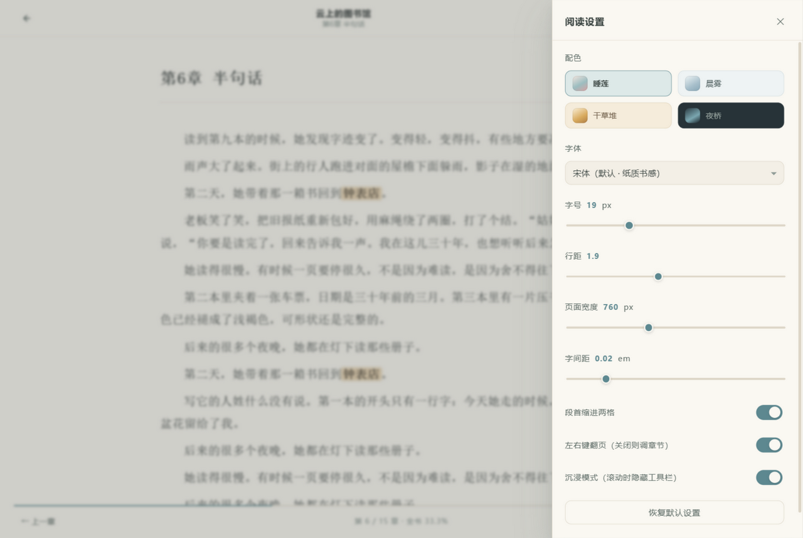

# 莫奈阅读器 · Nymphéa Reader

> 一个给 Windows 用的**本地小说阅读器**。配色取自莫奈的画——睡莲、干草堆、日本桥、晨雾下的塞纳河。
> 没有账号、没有广告、不联网，书全部存在你自己的电脑上。

界面是四个莫奈调色主题：**睡莲 / 晨雾 / 干草堆 / 夜桥**，白天读、晚上读都有合适的底色。


<details>
<summary>看看夜间配色和设置面板</summary>




</details>

---

## 特性

- **中文编码自动识别** —— UTF-8 / GBK / GB18030 / BIG5 / UTF-16 都能正确打开，网上下的老书不会再乱码
- **TXT 与 EPUB** —— EPUB 自动抽取正文，图片和样式忽略
- **自动分章** —— 认识「第一章 / 第 12 回 / 楔子 / 番外 / Chapter 3」等写法；没有章节号的书会按段落自动切节
- **网页抓来的书也能读** —— 会自动清掉「本章未完，点击下一页」「笔趣阁 www.xxx.com」这类残留行
- **封面自己画** —— 每本书按书名生成一幅小水彩画，同一本书永远是同一幅
- **进度记忆** —— 关掉程序再打开，还停在原来的章和位置
- **全书搜索** —— 搜到的每一处都能直接跳过去并高亮
- **阅读设置** —— 字体（宋体/楷体/雅黑/等线/仿宋）、字号、行距、页宽、字间距、段首缩进，改完即时生效
- **沉浸模式** —— 往下滚动时工具栏自动收起
- **键盘操作** —— `← →` 翻页，`[ ]` 换章，`T` 目录，`F` 搜索，`S` 设置，`C` 换配色

## 快速开始

**1. 装 Python（只需一次）**

如果电脑上还没有 Python，打开 PowerShell 或 CMD 运行：

```bat
winget install -e --id Python.Python.3.12
```

也可以到 [python.org/downloads](https://www.python.org/downloads/) 下载安装包，**安装时务必勾选 `Add python.exe to PATH`**。

**2. 下载这个项目**

点仓库页面右上角绿色的 `Code` → `Download ZIP`，解压到任意文件夹。

**3. 双击 `start.bat`**

会弹出一个独立的阅读器窗口（没有地址栏和标签页，看起来就是个桌面软件）。
第一次先点「导入图书」，或者直接把 `.txt` / `.epub` 拖进窗口。

> 黑底命令行窗口要留着别关，关掉就等于退出程序。

## 数据存在哪？怎么备份？

所有内容都在项目下的 `library/` 文件夹里：

```
library/
├── index.json      记录书名、作者、阅读进度
└── books/          每本书的正文（纯文本，可以直接打开看）
```

想备份就把整个 `library/` 文件夹复制走；换电脑时把它拷到新电脑的同一个位置，书架就回来了。

这个文件夹已经被 `.gitignore` 排除，**上传 GitHub 时不会被传上去**，不用担心私人书单被公开。

## 快捷键

| 按键 | 作用 |
| --- | --- |
| `←` `→` / `PageUp` `PageDown` / `空格` | 翻页（翻到头自动进下一章） |
| `↑` `↓` | 细滚动 |
| `[` `]` 或 `,` `.` | 上一章 / 下一章 |
| `Home` `End` | 章首 / 章末 |
| `T` | 目录 |
| `F` | 全书搜索 |
| `S` | 阅读设置 |
| `C` | 切换配色 |
| `Esc` | 关闭面板 / 回到书架 |

## 常见问题

**书打开是乱码？**
正常情况下会自动识别。如果确实乱码，说明编码比较特殊，可以先用记事本把文件「另存为」UTF-8 再导入。

**支持 PDF / MOBI / AZW3 吗？**
不支持。这个阅读器只做 TXT 和 EPUB，因为这两种最适合长时间阅读。

**能不能生成一个 exe，不用装 Python？**
可以自己打包（`pyinstaller --noconsole --add-data "app;app" server.py`），但项目本身不附带 exe——那样仓库会大很多，而且杀毒软件容易误报。

**会联网吗？会上传我的书吗？**
不会。整个程序只监听 `127.0.0.1`，不出本机。

## 项目结构

```
monet-reader/
├── start.bat              双击启动（Windows）
├── server.py              本地服务：静态托管 + 书库读写 + 编码识别 + EPUB 解析
├── app/                   前端界面（纯 HTML/CSS/JS，无构建步骤）
│   ├── index.html
│   ├── css/
│   │   ├── themes.css     四套莫奈配色，改色值就能换风格
│   │   └── style.css
│   └── js/
│       ├── app.js         主逻辑
│       ├── parser.js      章节识别、段落渲染、全书搜索
│       ├── storage.js     存储层（本地服务 / 浏览器内置数据库）
│       └── covers.js      封面生成（SVG 现画）
├── samples/               样例小说，导入就能看到效果
├── docs/                  截图与《GitHub 上传教程》
├── library/               你的书库（不在版本控制里）
└── LICENSE
```

前端和 Python 之间只用一个很小的 JSON 接口通信，想改成别的语言或者加功能都不难。

## 想上传到 GitHub？

写了份手把手的教程，包含「网页拖拽上传」和「Git 命令行」两条路线：
👉 **[docs/GitHub上传教程.md](docs/GitHub上传教程.md)**

## 版权说明

本程序只提供阅读器，不带任何书籍内容。`samples/` 里的三篇样例是本项目自己写的示范文本，可以随意使用。
请勿用本程序传播没有授权的小说。

## License

[MIT](LICENSE) —— 随便用、随便改，保留版权声明即可。
